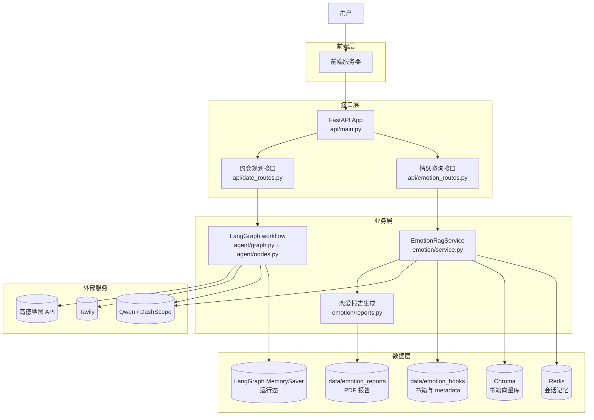
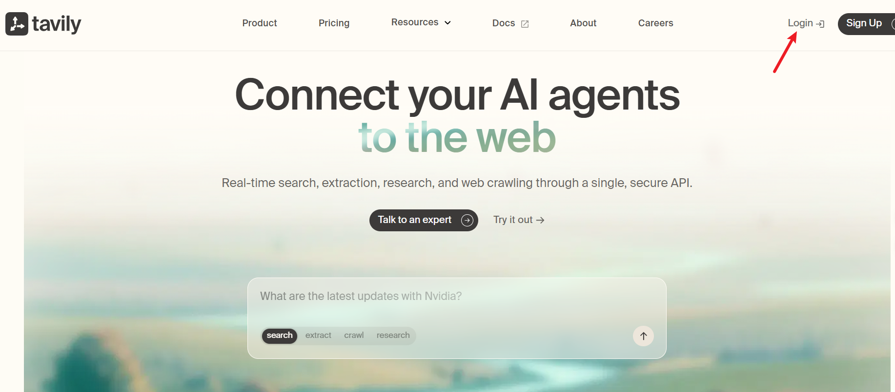
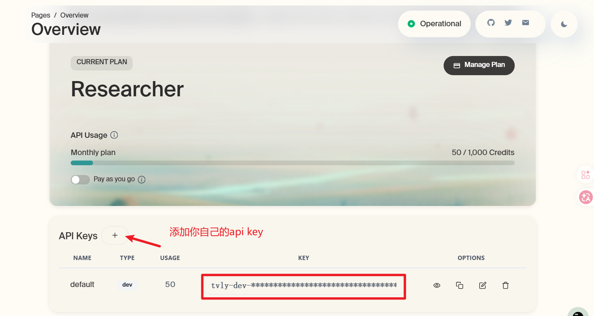
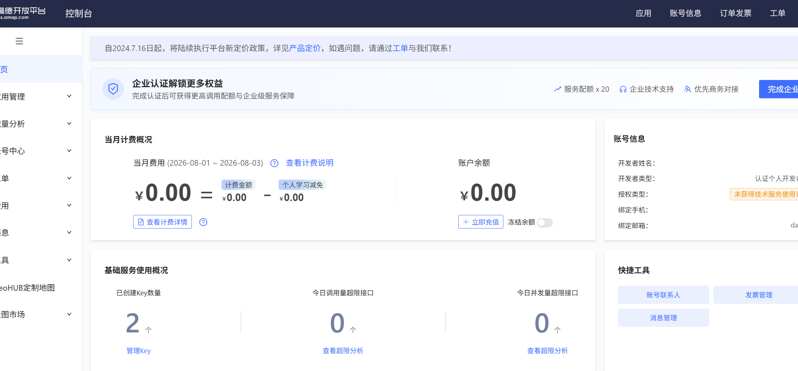
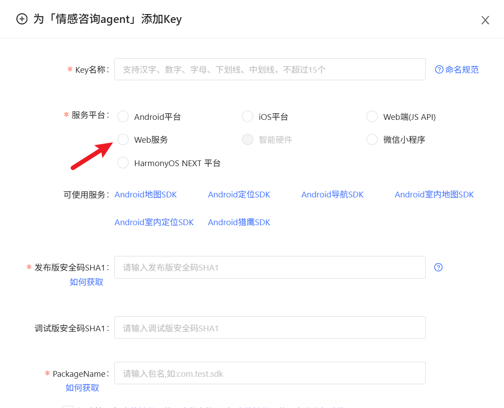
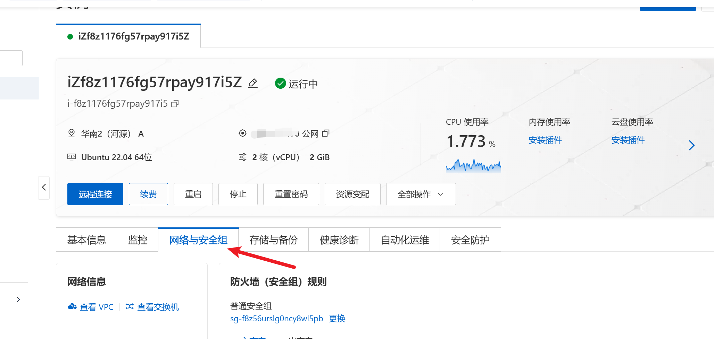

# 项目介绍
项目参考：https://github.com/langchain-samples/demos-travel-planner-agent
很多单身男女，尤其是恋爱经验较少的人，在追求喜欢的人、推进关系或面对暧昧信号时，常常会感到犹豫、彷徨和不知所措。即使是已经处在恋爱关系中的情侣，也可能会遇到沟通误会、情绪冲突、关系冷淡、相处边界不清等各种情感问题。因此，本项目提供了情感咨询功能，基于自己的恋爱知识库，为用户提供情感分析与建议。

同时，在恋爱约会过程中，用户往往还需要花费大量时间做约会前准备：查天气、查路线、选活动、找餐厅、考虑是否过夜、安排时间线等。为了减少这些繁琐的信息收集和行程规划成本，本项目还提供了约会行程规划功能，让用户更轻松地完成约会准备。

本项目主要包含两个核心功能：

- 情感咨询：基于多轮对话的形式为用户提供情感咨询，并支持生成恋爱报告 PDF。
- 约会行程规划：基于 LangGraph 实现复杂Workflow编排，包括用户信息收集、执行查联网查询，整理生成最终的约会计划，收集用户反馈，以及修正约会计划。

## 项目架构图



在我们整个项目中: 

- `FastAPI` (api/main.py)：统一接收前端发送的请求，**情感咨询**和**约会规划**这两个功能对应的是不同的接口
- `情感咨询`(agent/graph.py)：在执行时会访问Redis获取会话记忆，同时，也会查询向量数据库Chroma根据用户问题查询相关的书籍知识，然后发送大模型给出用户最终回复。如果用户输入"生成恋爱报告"这样的输入，则会根据用户的当前会话记忆生成恋爱报告的PDF。
- `约会规划`(emotion/service.py)：在执行时会利用LangGraph的MemorySaver保存运行时状态，保存收集到的用户信息，保存通过Travily联网搜索的信息，以及通过高德地图获取的实时位置信息等，最终把信息交给模型整理得到最终的约会计划

## 技术说明

在这个Python项目中，之前很多我们在JAVA语言中所使用的技术，都需要做替换

- 在JAVA项目中我们需要使用SpringMVC来完成这一功能，但本项目中使用FastAPI来实现这
- 之前我们学习了LangChain4j，SpringAI这样的框架来实现与模型的交互，但本项目中使用LangChain来实现
- 上一个项目中我们使用了Spring AI Alibaba来实现复杂工作流编排以及Human-In-Loop, 但是本项目中使用LangGraph来实现
- 上一个项目中我们虽然也有知识库，但是并未基于已有的文档数据来构造知识库，本项目会基于情感书籍内容(已有文档)来构造情感知识库

##  功能实现说明
情感咨询功本质上还是在实现多论对话，但是和上一个项目不同的地方在于不再做会话记忆的滚动压缩，在这个项目中我们就利用Redis来存储会话记忆，限定会话记忆的窗口为只包含最近的N条消息。

同时，为了更好的回复用户的情感问题，我们实现了完整的情感知识库构建，包括：文档加载，数据的清洗，切分，向量化，知识检索阶段还实现了用户问题的查询重写，尽可能查询和用户问题相关的知识

在约会行程规划中，我们会基于LangGraph实现复杂的workflow编排，同时还会使用网页搜索，路线查询等功能。

##  项目代码包结构

```text
demos-travel-planner-agent/
|-- api/                          后端接口层，负责接收前端请求
|   |-- main.py                    FastAPI 应用入口，创建 app，挂载路由和静态文件
|   |-- emotion_routes.py          情感咨询相关接口
|   |-- date_routes.py             约会行程规划相关接口
|   |-- schemas.py                 请求体数据结构
|   `-- sse.py                     SSE 工具，用于流式输出
|-- emotion/                      情感咨询业务层
|   |-- service.py                 情感咨询主服务：是否生成报告判断、是否RAG分支、对话链编排
|   |-- retrieval.py               知识库检索：Chroma 客户端、嵌入模型、MultiQueryRetriever
|   |-- memory.py                  会话记忆：Redis 历史读取、历史消息窗口裁剪
|   |-- prompts.py                 情感咨询用到的各类提示词常量
|   |-- reports.py                 恋爱报告：Markdown 流式生成 + ReportLab 渲染 PDF
|   `-- indexing/                  知识库构建子包（离线建索引）
|       |-- loader.py              按页加载 PDF，BookConfig、书籍目录扫描
|       |-- splitter.py            文本清洗、噪声过滤、RecursiveCharacterTextSplitter 切分
|       `-- service.py             构建流程编排：加载→切分→写入 Chroma
|-- agent/                        约会行程规划业务层
|   |-- graph.py                   LangGraph workflow 图定义（节点+边）
|   |-- nodes.py                   每个 workflow 节点的具体逻辑
|   |-- state.py                   workflow 运行过程中的状态结构（DateState）
|   |-- prompts.py                 约会规划用到的各类提示词
|   |-- clients.py                 Qwen、Tavily、高德地图等外部客户端
|   `-- date_parser.py             中文日期解析工具（基于 jionlp）
|-- core/                         项目公共配置
|   |-- settings.py                读取 .env，集中管理配置项
|   `-- llm.py                     统一创建 LLM 客户端的工厂方法
|-- data/                         项目数据目录
|   |-- emotion_books/             情感咨询书籍 PDF
|   `-- emotion_reports/           生成后的恋爱报告 PDF
|-- requirements.txt              Python 第三方依赖列表
|-- .env                          本地真实配置文件
`-- .env.example                  配置模板
```

从后端学习角度看，最重要的是三个包：

- `api/`：类似 SpringMVC 的 Controller 层，负责接收请求和返回响应。
- `emotion/`：情感咨询业务，包括会话记忆、知识库构建与检索、恋爱报告。
- `agent/`：约会行程规划业务，包括 LangGraph workflow 和各个节点。

##  项目启动

### 后端启动

需要首先把requirements.txt依赖包安装好

在 PyCharm 中运行后端时，不是随便运行某个业务文件，而是要运行 FastAPI 应用入口。

 uvicorn api.main:app --reload --port 8000

本项目的后端入口文件是：

```text
api/main.py
```

启动成功后，后端服务端口是：

```text
8000
```

### 前端启动

到https://nodejs.org/zh-cn/download下载node，双击安装，依次下一步


```powershell
cd front
npm run dev
```

默认前端开发端口是 `5173` 或 `5174`，取决于 Vite 当前占用情况。

## 第三方依赖说明

这个项目使用 `requirements.txt` 管理依赖，类似 Java 里的 `pom.xml`, 我们只需要执行如下命令，即可安装好所需的依赖

```cmd
pip install -r requirements.txt
```

之后就我们只用在需要的地方导入想要使用的目标即可


## 环境搭建


### 申请api_key

在我们的整个项目中，访问大模型，访问高德地图API，使用AI搜索工具Travily都需要申请对应的api_key，但是我们之前已经有了模型的api_key，以及高德地图的api_key,  因此在项目开始前，我们只需要在申请Travily的api_key即可。申请过程如下：





### 如何注册高德开放平台

访问https://lbs.amap.com/，注册，注册点击控制台

管理key



添加key时，要选择web服务




### 配置管理

在讲项目配置之前，先解释一个大家可能没接触过的概念——`.env` 文件。

**类比 Java：** 这其实就是 SpringBoot 里 `application.yml` / `application.properties` 干的事——把配置项集中放在一个文件里，和代码分离。

在 Python 生态里，最常见的做法就是用一个名为 `.env` 的纯文本文件来存放这些配置。`.env` 文件的格式非常简单，每行一个 `键=值`：

```env
DASHSCOPE_API_KEY=sk-xxxxxxxx
QWEN_MODEL=qwen-plus
CHROMA_PORT=8000
```


但是，光有 `.env` 文件还不够，得有代码把它读进来。这一步靠的是 `python-dotenv` 这个库（已在 `requirements.txt` 里）。

它的核心函数是 `load_dotenv()`：调用之后，它会读取 `.env` 文件，把里面的每一行 `键=值` 都注册成**环境变量**。注册之后，代码里就能通过 `os.getenv("键名")` 把值取出来。

项目里这部分逻辑都集中在 `core/settings.py`：

```python
import os
from dataclasses import dataclass
from pathlib import Path
from dotenv import load_dotenv

# 项目根目录
# __file__这是一个内置变量，表示当前正在执行的这个 Python 脚本的文件路径
# Path(__file__)：将路径字符串转换成一个“路径对象”
# .resolve()：获取路径对象所代表的绝对路径
# parents[1]：当前文件所在目录的上一级目录
PROJECT_ROOT = Path(__file__).resolve().parents[1]

# 关键一步：加载项目根目录下的 .env 文件，把里面的配置变成环境变量
load_dotenv(PROJECT_ROOT / ".env")


@dataclass(frozen=True)
class Settings:
    # os.getenv("键名") 读取环境变量（也就是 .env 里的配置）
    dashscope_api_key: str | None = os.getenv("DASHSCOPE_API_KEY")

    # os.getenv("键名", "默认值")：如果 .env 里没配，就用默认值
    qwen_model: str = os.getenv("QWEN_MODEL", "qwen-plus")
    chroma_port: int = int(os.getenv("CHROMA_PORT", "8000"))  # 注意：取出来都是字符串，需要时要手动转 int
    # ...其他配置项


# 创建一个全局唯一的配置对象，其他文件直接 from core.settings import settings 使用
settings = Settings()
```

几个要点：

- **`load_dotenv` 必须在读取配置之前调用**：它负责把 `.env` 加载进环境变量，没加载就 `getenv` 不到。
- **`os.getenv` 取出来的值都是字符串**：所以像端口号、维度这类需要数字的，要手动 `int(...)` 转换。
- **集中成一个 `Settings` 对象**：把所有配置项都收拢到一个类里，其他业务代码用的时候只要 `settings.dashscope_api_key` 这样点出来即可，不用到处写 `os.getenv`。这个 `settings` 对象就相当于 SpringBoot 里被 `@Value` / `@ConfigurationProperties` 注入好的配置 Bean。

下面是项目根目录 `.env` 文件的完整配置示例（`.env.example` 是它的模板，第一次用时把 `.env.example` 复制为 `.env` 再填入自己的值）：

```env
# ===== 大模型（通义千问，OpenAI 兼容接口）=====
DASHSCOPE_API_KEY=your-dashscope-key-here
QWEN_MODEL=qwen-plus
QWEN_BASE_URL=https://dashscope.aliyuncs.com/compatible-mode/v1

# ===== 联网搜索（Tavily）和 地图（高德）=====
TAVILY_API_KEY=your-tavily-key-here
AMAP_API_KEY=your-amap-key-here
MAP_TIMEOUT_SECONDS=5

# ===== 向量数据库 Chroma =====
CHROMA_HOST=192.168.150.109
CHROMA_PORT=8000

# ===== 情感咨询知识库 =====
EMOTION_COLLECTION_NAME=emotion_books      # 向量库 collection 名称
EMOTION_EMBED_MODEL=text-embedding-v3      # 嵌入模型
EMOTION_EMBED_DIM=1024                      # 向量维度
EMOTION_SIMILARITY_TOP_K=4                  # 检索返回的片段数量

# ===== 会话记忆 Redis =====
REDIS_URL=redis://192.168.150.109:6379/0
EMOTION_REDIS_KEY_PREFIX=emotion:chat:      # Redis key 前缀
EMOTION_MEMORY_TTL_SECONDS=604800           # 会话记忆过期时间（7天）
EMOTION_MEMORY_WINDOW_MESSAGES=20           # 会话记忆窗口（保留最近20条）

# ===== 恋爱报告 PDF 输出目录 =====
EMOTION_REPORTS_DIR=data/emotion_reports
```

### 书籍数据

情感咨询的书籍放在：

```text
data/emotion_books/
```

每本书一个目录，目录里至少要有：

```text
metadata.json
正文文件（txt / md / pdf）
```

`metadata.json` 必须使用 UTF-8 编码。

### Chroma(跳过)

Chroma 可以使用 Docker 部署。先拉取镜像：（未使用Docker）

```powershell
docker pull chromadb/chroma:1.0.20
```

然后启动容器：

```powershell
docker run -d \
 --name chroma \
 --restart=always \
  -p 8000:8000 \
  -v D:\chroma-data:/chroma/chroma \
  chromadb/chroma:1.0.20
```

这条命令的含义是：

- `--name chroma`：容器名称叫 `chroma`
- `-p 8000:8000`：把宿主机的 `8000` 端口映射到容器的 `8000` 端口
- `-v D:\chroma-data:/chroma/chroma`：把向量数据库数据保存到宿主机目录，避免容器删除后数据丢失

启动后，项目通过下面配置连接 Chroma：

```env
CHROMA_HOST=192.168.150.109
CHROMA_PORT=80001
```
#### 1. 在 Ubuntu 安装 Chroma（跳过）

1. **Docker 安装（推荐）**

   如果你的 Ubuntu 已经装好 Docker，可以直接拉取官方镜像启动 Chroma：

   ```bash
   docker pull chromadb/chroma:1.0.20
   docker run -d \
     --name chroma \
     --restart=always \
     -p 8000:8000 \
     -v /opt/chroma-data:/chroma/chroma \
     chromadb/chroma:1.0.20
   ```

   - `/opt/chroma-data` 用于本地持久化数据目录，可自定义。
   - `-p 8000:8000` 让主机 8000 端口对外暴露。

2. **裸机安装（可选）**

   创建 Python 虚拟环境并安装 Chroma：

   ```bash
   sudo apt update
   pip3 install chromadb
   chroma run --host 0.0.0.0 --port 8000
   ```

   > 注意 `--host 0.0.0.0`，否则只能本机访问。

### 如何在Ubuntu安装chroma及使用

pip3 -V

如果没有pip3，就需要安装

sudo apt update

sudo apt install python3-pip -y


pip3 install chromadb

启动向量数据库

chroma run --host 0.0.0.0 --port 8000

### 在 Ubuntu 上部署 Chroma 与 Redis，并支持 Windows 远程连接

很多同学开发环境是 Windows，需要远程连接 Ubuntu 服务器的向量数据库（Chroma）和缓存（Redis）。下面教大家如何在 Ubuntu 环境下分别安装、配置，以及如何让 Windows 客户端远程访问。


---

#### 2. 在 Ubuntu 安装 Redis 并放开远程连接

1. **安装 Redis**

   ```bash
   sudo apt update
   sudo apt install redis-server -y
   ```

2. **修改配置允许远程连接**

   编辑配置文件：

   ```bash
   sudo vim /etc/redis/redis.conf
   ```

   找到 `bind` 行，改为：

   ```
   bind 0.0.0.0
   ```

   找到 `protected-mode yes`，可以改成：

   ```
   protected-mode no
   ```

   > 仅建议内网环境关闭保护，生产注意加密码、设置防火墙。

3. **重启 Redis**

   ```bash
   sudo systemctl restart redis-server
   ```

   测试：

   ```bash
   redis-cli -h 127.0.0.1 ping
   ```

---

#### 3. Windows 客户端远程连接方法

1. **确保 Ubuntu 防火墙（如 ufw）允许对应端口（如 6379, 8000）开放(只有用阿里云ECS的才需要开放）：**

   ```bash
   sudo ufw allow 6379
   sudo ufw allow 8000
   ```

   

2. **获取 Ubuntu 主机的内网/公网 IP 地址：**

   ```bash
   ip addr # 或者 ifconfig
   ```

3. **Windows 中 .env 配置举例：**

   ```env
   # 以远程 Ubuntu 服务器 IP 为例
   CHROMA_HOST=192.168.123.45
   CHROMA_PORT=8000
   
   REDIS_HOST=192.168.123.45
   REDIS_PORT=6379
   ```

4. **本地测试：**

   - 可用 `telnet 192.168.123.45 8000`、`telnet 192.168.123.45 6379` 测试端口连通。
   - 若连不上，优先排查云服务器控制台安全组、Ubuntu 防火墙、容器是否绑定了正确的 0.0.0.0 端口。

---

> ⚠️ 安全提示：生产环境千万不要将 Redis/Chroma “裸”暴露在公网，务必设置访问密码、加白名单、限制入网 IP，或通过内网/隧道访问！

---