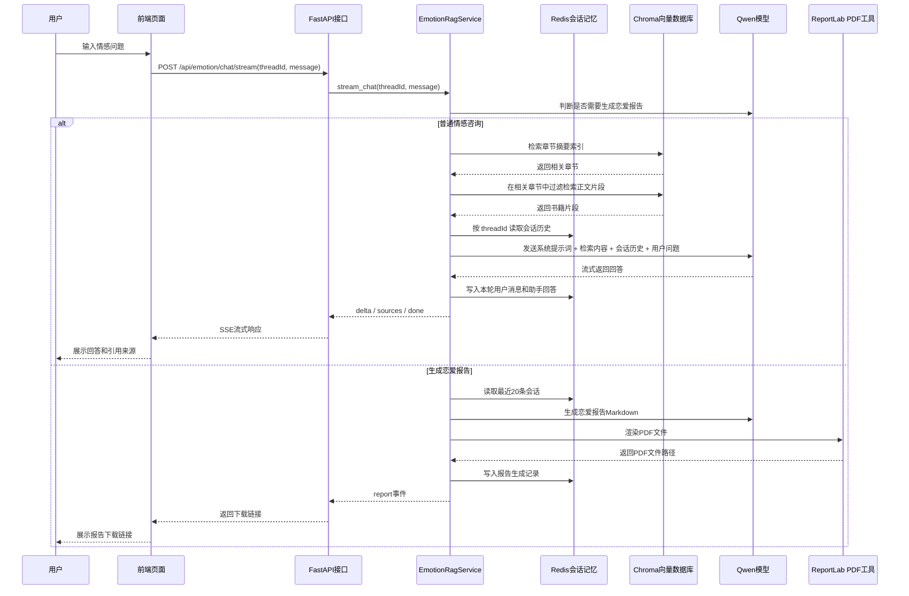
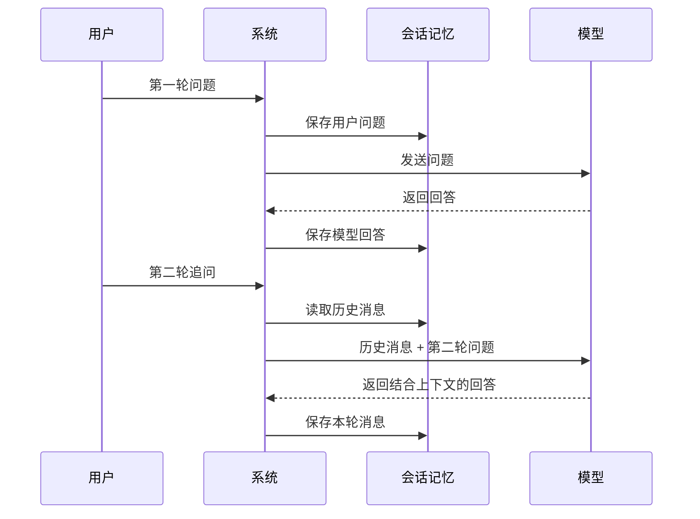
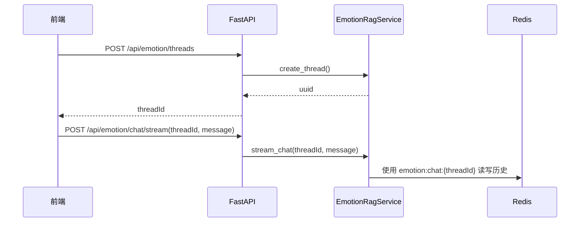
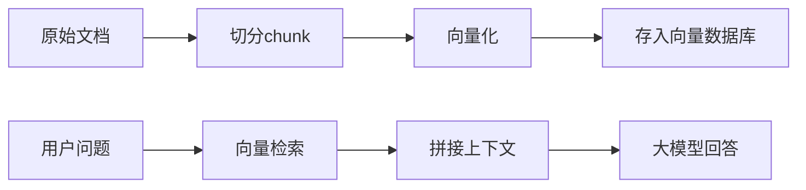
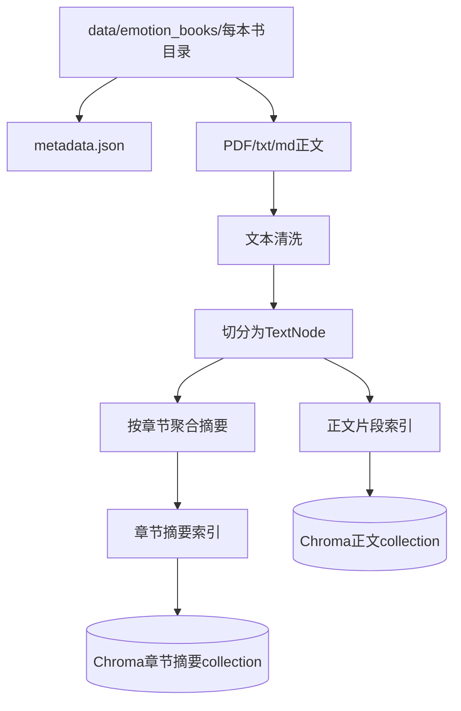
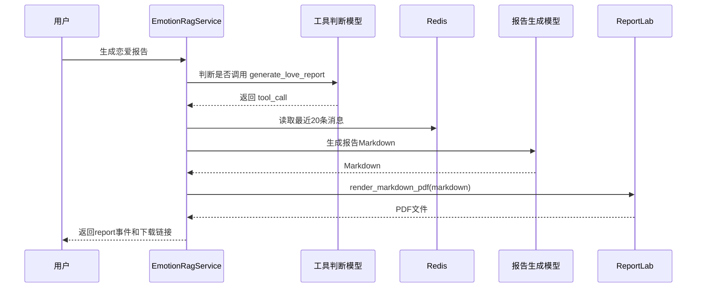

# 情感咨询功能

本节开始讲解项目中的情感咨询功能，主要内容包括普通情感咨询多轮对话、基于书籍知识库的 RAG 检索，以及恋爱报告 PDF 生成。

这部分代码主要位于：

```text
api/emotion_routes.py      情感咨询 HTTP 接口
emotion/service.py         情感咨询主业务服务
emotion/text_cleaning.py   书籍文本清洗
emotion/book_splitter.py   书籍切分和 metadata 构造
emotion/index_builder.py   LlamaIndex 索引构建
emotion/retrieval.py       LlamaIndex 检索
emotion/reports.py         恋爱报告 Markdown 和 PDF 生成
```

## 功能介绍

情感咨询功能不是简单地把用户问题直接发给大模型。它完整做了几件事：

- 保存并隔离每个用户会话
- 根据用户问题路由到合适的书籍
- 先检索相关章节，再在章节内检索正文片段
- 把检索结果和会话历史一起交给模型
- 流式返回模型回答
- 在用户要求生成恋爱报告时，调用工具生成 PDF

### 情感咨询时序图



对应文字说明：

- 用户在前端新建一次情感咨询，会先得到一个 `threadId`。
- 后续每一次聊天，前端都会把 `threadId` 和用户消息一起发给后端。
- 后端使用 `threadId` 区分不同会话，避免不同用户或不同咨询之间的记忆串扰。
- 普通咨询时，系统会先查书籍知识库，再把检索结果放进提示词。
- 如果用户表达“生成恋爱报告”“导出关系报告”等意图，系统会走工具调用逻辑，生成 PDF。
- 回答使用 SSE 流式返回，前端可以边生成边展示。

项目依赖在 `requirements.txt` 中：

```text
fastapi==0.136.1
uvicorn==0.46.0
```

## 3. 情感咨询多轮对话

### 3.1 多轮对话的本质

大模型本身是无状态的。它不会自动记住用户上一轮说过什么。

所以多轮对话的核心是：

```text
每次请求模型时，都把必要的历史消息一起带过去。
```

简单时序图：



要实现多轮对话，需要解决两个问题：

- 模型通信：如何调用模型、发送提示词、接收结果。
- 会话记忆：如何保存历史消息，如何隔离不同用户，如何控制历史长度。

本项目使用 LangChain 解决模型调用和会话接入，使用 Redis 保存会话记忆。

## 4. LangChain 框架使用

### 4.1 依赖和导入

项目中相关依赖包括：

```text
langchain
langchain-core
langchain-community
langchain-openai
redis
```

### 4.2 一轮对话

最简单的一轮对话：

```python
from langchain_openai import ChatOpenAI

llm = ChatOpenAI(
    model="qwen-plus",
    api_key="你的DashScope Key",
    base_url="https://dashscope.aliyuncs.com/compatible-mode/v1",
)

response = llm.invoke("怎么判断对方是不是对我有好感？")
print(response.content)
```

加入系统提示词和用户提示词：

```python
from langchain_core.prompts import ChatPromptTemplate
from langchain_openai import ChatOpenAI

prompt = ChatPromptTemplate.from_messages(
    [
        ("system", "你是一个温和、理性的情感咨询助手。"),
        ("human", "{question}"),
    ]
)

llm = ChatOpenAI(model="qwen-plus", api_key="你的Key", base_url="你的base_url")

chain = prompt | llm
response = chain.invoke({"question": "对方忽冷忽热，我该怎么办？"})
print(response.content)
```

增加工具调用：

```python
from langchain_core.tools import tool
from langchain_openai import ChatOpenAI


@tool("generate_love_report")
def generate_love_report(report_title: str = "") -> str:
    # 工具函数可以被模型调用
    return f"报告已生成：{report_title or '恋爱关系观察报告'}"


llm = ChatOpenAI(model="qwen-plus", api_key="你的Key", base_url="你的base_url")
tool_llm = llm.bind_tools([generate_love_report])
```

结构化输出通常使用 Pydantic 定义结构。本项目中工具参数就是 Pydantic 模型：

```python
class LoveReportToolArgs(BaseModel):
    report_title: str = Field(default="", description="可选报告标题。")
    focus: str = Field(default="", description="用户希望报告重点关注的内容。")
```

流式输出：

```python
for chunk in chain.stream({"question": "我应该主动吗？"}):
    print(chunk.content, end="")
```

项目中的情感咨询接口就是用流式方式返回：

```python
for chunk in self._chain_with_history().stream(
    {"question": clean_message, "context": context},
    config={"configurable": {"session_id": thread_id}},
):
    text = self._chunk_text(chunk)
    if text:
        yield {"type": "delta", "text": text}
```

## 5. 会话记忆和隔离

### 5.1 存在哪：RedisChatMessageHistory

LangChain 提供了多种消息历史存储方式，比如内存、Redis、数据库等。本项目选择 Redis：

```python
def _history(self, thread_id: str) -> RedisChatMessageHistory:
    if not settings.redis_url:
        raise RuntimeError("缺少 REDIS_URL。")
    return RedisChatMessageHistory(
        session_id=thread_id,
        url=settings.redis_url,
        key_prefix=settings.emotion_redis_key_prefix,
        ttl=settings.emotion_memory_ttl_seconds,
    )
```

这里最重要的是：

```text
session_id = thread_id
key_prefix = emotion:chat:
```

所以不同会话对应不同 Redis key：

```text
emotion:chat:{threadId}
```

### 5.2 存多少：滑动窗口

不能无脑把所有历史消息都传给模型，原因有三个：

- 模型上下文长度有限。
- 历史太长会增加调用成本。
- 太久远的内容可能干扰当前问题。

当前项目保留最近 N 条消息，默认 20 条：

```python
def _trim_message_history(self, history: Any) -> None:
    messages = history.messages
    if len(messages) <= self.memory_window_messages:
        return
    history.clear()
    history.add_messages(messages[-self.memory_window_messages :])
```

注意，这个裁剪逻辑是项目自己实现的。LangChain 负责接入 Redis 和读写消息，但不会自动帮我们裁剪 Redis 中的历史。

### 5.3 如何隔离不同用户

会话隔离靠 `threadId`。



如果用户 A 和用户 B 的 `threadId` 不同，他们的 Redis 会话历史就不会混在一起。

### 5.4 项目中的多轮对话链

```python
prompt = ChatPromptTemplate.from_messages(
    [
        (
            "system",
            """你是中文情感咨询助手，只能基于检索到的书籍内容回答用户问题。

检索到的书籍内容：
{context}""",
        ),
        MessagesPlaceholder("history"),
        ("human", "{question}"),
    ]
)
```

关键点：

- `{context}` 放知识库检索结果。
- `MessagesPlaceholder("history")` 放 Redis 中读出的历史消息。
- `{question}` 放用户本轮问题。

接着用 `RunnableWithMessageHistory` 把 chain 和 Redis 历史接起来：

```python
self._chain = RunnableWithMessageHistory(
    prompt | llm,
    self._history,
    input_messages_key="question",
    history_messages_key="history",
)
```

## 6 知识预处理

项目中的情感咨询不是完全依靠模型凭空回答，而是基于专业书籍构造的知识库来回答。但是在使用这些书籍中的知识之前，有一个小问题

但书籍内容不能直接丢进向量数据库，因为 PDF 抽出来的文本经常有问题：

- 页眉页脚和广告水印会进入正文，例如某些 PDF 里会有固定推广水印。
- 页码可能被当成正文，影响检索质量。
- 标题可能被拆开，例如“第 二 章”被抽成多行。
- 小标题和正文可能粘在一起，例如《科学脱单指南》第八章内部小标题和后文粘连。
- 图表标题和上下文可能分散，如果不补充上下文，用户问图表相关内容时召回不到。
- 目录页包含大量标题，但不是真正正文，容易污染索引。

所以知识库构建中，最麻烦的不是调用模型，而是把书籍文本清洗成适合检索的结构化片段。

### 6.2 数据清洗

清洗逻辑主要在 `emotion/text_cleaning.py`。

入口函数：

```python
def normalize_extracted_text(text: str, book_name: str | None = None) -> str:
    normalized = text
        # 针对 PDF 中的水印、页码、标题碎片做清洗
    elif book_name == ATTRACTION_BOOK_NAME:
        # 针对《吸引力的秘密》的水印和标题空格做清洗
        normalized = clean_attraction_raw_text(normalized)
        normalized = normalize_attraction_text(normalized)
        return normalized.strip()

    # 合并中文之间多余空格
    normalized = re.sub(r"(?<=[\u4e00-\u9fff])\s+(?=[\u4e00-\u9fff])", "", normalized)

    # 合并普通空白字符
    normalized = re.sub(r"[ \t\r\f\v]+", " ", normalized)

    # 减少连续空行
    normalized = re.sub(r"\n{3,}", "\n\n", normalized)

    # 给章节标题、小标题补换行，方便后面识别结构
    normalized = insert_structure_breaks(normalized, book_name=book_name)
    return normalized.strip()
```

以 PDF 文本清洗为例：

### 6.3 文档切分和 metadata

清洗完成后，要把文本切成 LlamaIndex 的 `TextNode`。

核心代码在 `emotion/book_splitter.py`：

```python
def split_llama_documents(
    documents: list[Any],
    target_chars: int = 900,
    max_chars: int = 1200,
    min_chars: int = 120,
) -> list[TextNode]:
    nodes: list[TextNode] = []
    current_chapter = ""
    current_section = ""

    for document in documents:
        text = str(getattr(document, "text", "") or "").strip()
        if not text:
            continue

        metadata = base_node_metadata(document)
        book_name = str(metadata.get("book_name") or "")

        # 先清洗 PDF 抽取文本
        text = normalize_extracted_text(text, book_name=book_name)
        if not text or should_skip_page(text):
            continue

        page = getattr(document, "metadata", {}).get("page")
        blocks = split_page_blocks(text)

        for block_index, block in enumerate(blocks):
            title = detect_heading(block)

            # 如果识别到标题，就更新当前章节或小节
            if title:
                if is_chapter_heading(title):
                    current_chapter = title
                    current_section = ""
                else:
                    current_section = title
                continue

            # 普通正文按句子和长度切成 chunk
            for chunk in chunk_paragraph(block, target_chars, max_chars, min_chars):
                if not chunk or is_noise_chunk(chunk):
                    continue

                node_metadata = dict(metadata)
                node_metadata.update(
                    {
                        "chapter_title": current_chapter,
                        "section_title": current_section,
                        "page_start": page,
                        "page_end": page,
                    }
                )
                nodes.append(TextNode(text=chunk, metadata=node_metadata))

    return merge_short_nodes(nodes, min_chars=min_chars, max_chars=max_chars)
```

这里的关键是 metadata：

```text
book_name
book_title
file_name
chapter_title
section_title
page_start
page_end
content_type
```

后续能做章节过滤检索，靠的就是这些 metadata。

## 7. 知识库构建

### 7.1 普通 RAG 回顾

传统 RAG 通常是：



这种方式能用，但对于书籍有一个问题：它主要匹配片段，容易忽略“书籍 - 章节 - 小节 - 内容”的结构。

人查书时，通常不是直接全文随机找一句，而是：

```text
先判断该看哪本书
-> 再判断该看哪个章节
-> 最后到章节中找具体内容
```

本项目就是按这个思路构建知识库。

### 7.2 LlamaIndex 在项目中的作用

LlamaIndex 在本项目中主要负责：

- 使用 `Document` 和 `TextNode` 表示文档和切分节点
- 使用 `VectorStoreIndex` 构建向量索引
- 使用 `ChromaVectorStore` 对接 Chroma
- 使用 retriever 执行检索
- 使用 `PydanticMultiSelector` 做多本书路由

项目没有使用 LlamaIndex 默认切分器，而是自己做清洗和切分，然后把 `TextNode` 交给 LlamaIndex 建索引。

### 7.3 项目的二级索引结构



每本书会创建两类 collection：

- 正文片段 collection：保存具体片段，用于最终回答。
- 章节摘要 collection：保存每个章节的摘要，用于先定位相关章节。

### 7.4 构建索引代码

代码在 `emotion/index_builder.py`：

```python
def build_book_vector_store(config: BookConfig) -> int:
    # 配置 LlamaIndex 使用 Qwen embedding 和 Qwen LLM
    configure_llama_index()

    # 加载 PDF/txt/md，得到 LlamaIndex Document
    documents = load_llama_documents(config)
    if not documents:
        raise ValueError("没有找到支持的书籍文件，当前支持 txt/md/pdf。")

    # 清洗并切分为 TextNode
    nodes = split_llama_documents(documents)
    if not nodes:
        raise ValueError("书籍内容为空，无法构建索引。")

    # 每次重建前删除旧 collection，避免旧数据残留
    client = chroma_client()
    try:
        client.delete_collection(config.collection_name)
    except Exception:
        pass

    # 构建正文片段索引
    vector_store = create_vector_store(config)
    storage_context = StorageContext.from_defaults(vector_store=vector_store)
    VectorStoreIndex(nodes, storage_context=storage_context, show_progress=False)

    # 构建章节摘要索引
    summary_nodes = build_chapter_summary_nodes(config, nodes)
    if summary_nodes:
        summary_store = create_summary_vector_store(config)
        summary_storage_context = StorageContext.from_defaults(vector_store=summary_store)
        VectorStoreIndex(summary_nodes, storage_context=summary_storage_context, show_progress=False)

    return len(nodes)
```

触发索引构建的 Web 接口是：

```python
@router.post("/indexes/build")
def build_emotion_indexes(req: EmotionBuildRequest) -> dict[str, Any]:
    try:
        results = emotion_service.build_indexes(req.book_name)
    except Exception as exc:
        results = [{"bookName": req.book_name or "*", "status": "error", "error": str(exc)}]
    return {"results": results}
```

接口路径：

```text
POST /api/emotion/indexes/build
```

## 8. 知识库检索

检索过程分三步：

```text
1. 多本书路由：判断用户问题更适合查哪本书
2. 章节路由：先查章节摘要索引，定位相关章节
3. 正文检索：使用 metadata filter 到相关章节内查正文片段
```

### 8.1 多本书路由

代码在 `emotion/book_router.py`：

```python
def route_books(configs: list[BookConfig], query: str, max_books: int) -> list[tuple[BookConfig, str]]:
    if len(configs) == 1:
        return [(configs[0], "只有一本候选书籍。")]

    configure_llama_index()
    choices = [
        ToolMetadata(
            name=safe_tool_name(config),
            description=book_route_description(config),
        )
        for config in configs
    ]

    selector = PydanticMultiSelector.from_defaults(max_outputs=max(1, min(max_books, len(configs))))
    selection = selector.select(choices, query)
```

它不是简单字符串匹配，而是让 LlamaIndex selector 根据书籍描述和用户问题选择一本或多本书。

### 8.2 章节摘要检索

代码在 `emotion/service.py`：

```python
def _route_chapters(self, query: str, config: BookConfig) -> list[str]:
    summaries = query_chapter_summaries(config, query, top_k=self.chapter_route_top_k)
    best_score = max((float(score) for _document, score in summaries), default=0.0)

    chapters: list[str] = []
    seen: set[str] = set()
    for document, score in summaries:
        if best_score > 0 and float(score) < best_score * self.chapter_route_min_score_ratio:
            continue
        chapter = str((document.metadata or {}).get("chapter_title") or "").strip()
        if chapter and chapter not in seen:
            seen.add(chapter)
            chapters.append(chapter)
    return chapters
```

这里先查章节摘要索引，得到相关章节标题。

### 8.3 正文片段检索

代码在 `emotion/retrieval.py`：

```python
def query_book(
    config: BookConfig,
    query: str,
    top_k: int,
    filters: dict[str, MetadataValue] | None = None,
) -> list[tuple[LangChainDocument, float]]:
    configure_llama_index()
    vector_store = create_vector_store(config)
    storage_context = StorageContext.from_defaults(vector_store=vector_store)
    index = VectorStoreIndex.from_vector_store(vector_store=vector_store, storage_context=storage_context)

    # filters 可以限制只在某些章节中检索
    retriever = index.as_retriever(similarity_top_k=top_k, filters=to_metadata_filters(filters))
    return retrieve_langchain_documents(retriever, query)
```

章节过滤检索：

```python
for document, score in query_book(
    config,
    query,
    max(self.similarity_top_k, 6),
    filters={"chapter_title": chapters},
):
    ...
```

这就是前面说的：

```text
先查章节
-> 再在章节内查正文
```

### 8.4 和 LangChain 对话整合

检索结果会被整理成上下文：

```python
def _context_block(self, hits: list[SearchHit]) -> str:
    blocks: list[str] = []
    for index, hit in enumerate(hits, start=1):
        metadata = hit.document.metadata or {}
        title = metadata.get("book_title") or metadata.get("book_name") or "未知书籍"
        chapter = str(metadata.get("chapter_title") or "").strip()
        section = str(metadata.get("section_title") or "").strip()
        text = re.sub(r"\s+", " ", hit.document.page_content or "").strip()
        blocks.append(f"[{index}]《{title}》{chapter} / {section}\n{text}")
    return "\n\n".join(blocks)
```

然后作为 `{context}` 放进 prompt：

```python
for chunk in self._chain_with_history().stream(
    {"question": clean_message, "context": context},
    config={"configurable": {"session_id": thread_id}},
):
    ...
```

## 9. 恋爱报告

恋爱报告不是普通问答，而是一个工具调用场景。

### 9.1 恋爱报告时序图



### 9.2 工具判断

工具参数：

```python
class LoveReportToolArgs(BaseModel):
    report_title: str = Field(default="", description="可选报告标题。")
    focus: str = Field(default="", description="用户希望报告重点关注的内容。")
```

工具绑定：

```python
@tool("generate_love_report", args_schema=LoveReportToolArgs)
def generate_love_report(report_title: str = "", focus: str = "") -> str:
    report = self._execute_love_report_tool(
        thread_id=thread_id,
        report_title=report_title,
        focus=focus,
    )
    return f"报告已生成：{report.download_url}"
```

### 9.3 读取最近20条会话

```python
def _execute_love_report_tool(self, thread_id: str, report_title: str = "", focus: str = "") -> LoveReport:
    messages = self._history(thread_id).messages[-self.memory_window_messages :]
    return generate_love_report_from_messages(messages, focus=focus, report_title=report_title)
```

报告只基于最近 20 条消息，不会凭空编造。

### 9.4 生成 Markdown 报告

代码在 `emotion/reports.py`：

```python
def generate_love_report_from_messages(messages: list[BaseMessage], focus: str = "", report_title: str = "") -> LoveReport:
    user_message_count = sum(
        1 for message in messages
        if isinstance(message, HumanMessage) and _message_text(message).strip()
    )
    if user_message_count < 2:
        raise ValueError("当前对话信息不足，至少需要完成两轮咨询后再生成恋爱报告。")

    conversation = format_report_conversation(messages)
    markdown = generate_report_markdown(conversation)
    ...
    render_markdown_pdf(markdown, path, title=title)
    return LoveReport(...)
```

报告提示词要求固定输出这些章节：

```text
1. 报告依据
2. 当前关系画像
3. 你的核心情感需求
4. 关系中的积极信号
5. 需要警惕的黄灯/红灯信号
6. 关系模式分析
7. 给你的行动建议
8. 温和提醒
```

### 9.5 使用 ReportLab 生成 PDF

`reportlab` 负责把 Markdown 文本渲染成 PDF。

关键代码：

```python
def render_markdown_pdf(markdown: str, path: Path, title: str = "恋爱关系观察报告") -> None:
    from reportlab.lib.pagesizes import A4
    from reportlab.platypus import Paragraph, SimpleDocTemplate, Spacer

    font_name = register_chinese_font(pdfmetrics, TTFont)

    story: list[Any] = []
    for line in markdown_to_lines(markdown):
        if line.startswith("# "):
            story.append(Paragraph(escape_pdf_text(line[2:].strip() or title), styles["CnTitle"]))
        elif line.startswith("## "):
            story.append(Paragraph(escape_pdf_text(line[3:].strip()), styles["CnHeading"]))
        elif line.startswith("- "):
            story.append(Paragraph(f"• {escape_pdf_text(line[2:].strip())}", styles["CnBullet"]))
        else:
            story.append(Paragraph(escape_pdf_text(line), styles["CnBody"]))

    document = SimpleDocTemplate(str(path), pagesize=A4, title=title)
    document.build(story)
```

ReportLab 本身偏底层，所以项目这里只做简单排版，不做复杂样式。

## 10. 小结

情感咨询功能可以拆成三条主线：

```text
多轮对话主线：
FastAPI -> EmotionRagService -> LangChain -> Redis -> Qwen

知识库主线：
书籍文件 -> 文本清洗 -> TextNode切分 -> LlamaIndex -> Chroma -> Retriever

恋爱报告主线：
用户意图 -> Tool Calling -> Redis最近20条消息 -> Qwen生成Markdown -> ReportLab生成PDF
```

学习这部分时，不建议一开始就陷入每条清洗规则。先抓住主流程：

```text
接收请求
-> 读取记忆
-> 检索知识
-> 生成回答
-> 保存记忆
-> 必要时生成报告
```

等主线理解后，再回头看书籍清洗、章节识别和图表处理这些细节，会更容易掌握。
